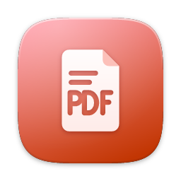
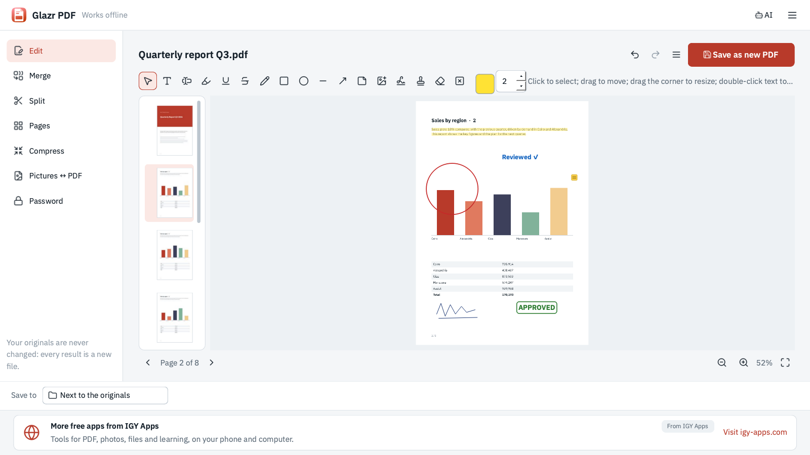
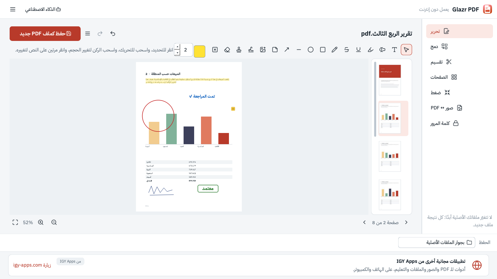

# Glazr PDF

Free PDF editor and tools for **macOS** and **Windows** by [IGY Apps](https://igy-apps.com).

- **Edit** (new in 1.1): add text (Arabic too) and change existing lines, highlight, underline and
  strike, draw, shapes, notes, pictures and stamps; **sign** (draw, type or a picture); **fill
  forms**; **redact** private information for real (it leaves the file); watermark and page numbers.
- **Merge** PDFs and pictures into one PDF, in the order you choose (drag to reorder).
- **Split** a PDF into single pages, every N pages or the ranges you type, or keep only the pages
  you need.
- **Pages:** see every page as a thumbnail, then reorder, turn, delete, duplicate or crop pages,
  insert blank pages or pages from another PDF, and save a new PDF.
- **Compress** PDFs for WhatsApp and email, with the size before and after; when a file can't get
  smaller, the original is kept.
- **Pictures ↔ PDF:** photos and scans to one PDF (page size, orientation, margins), or PDF pages
  to JPG or PNG.
- **Password:** protect a copy with an AES-256 password, or save a copy without a password you
  know. It never guesses, cracks or bypasses passwords.
- **Your originals are never changed or deleted**, and no file is overwritten (`report_merged_2.pdf`…).
- **For scripts and AI assistants:** the `glazr-pdf` command does the same from a terminal with
  JSON output; "Copy instructions for AI" prepares a ready prompt for ChatGPT, Claude or Codex.
- Free, no account. Works **offline**. Arabic (right to left), English, French and German.



## Download

| System | Where |
|---|---|
| macOS 12 or newer, Apple Silicon (M1 or newer) | **[Releases](https://github.com/islammohy/glazr-pdf-desktop/releases/latest)**: `Glazr-PDF-<version>-macOS-arm64.dmg` |
| Windows 10/11 | Coming to the **Microsoft Store** |

Open the `.dmg` and drag Glazr PDF to Applications. The app is signed with a Developer ID and
notarized by Apple. Intel Macs are not supported in this version. Check a download against
`SHA256SUMS.txt` in the same release if you like: `shasum -a 256 <file>`.

On macOS the command line is the program inside the app:

```bash
"/Applications/Glazr PDF.app/Contents/MacOS/Glazr PDF" merge ~/Documents/a.pdf ~/Documents/b.pdf --json
"/Applications/Glazr PDF.app/Contents/MacOS/Glazr PDF" add-text ~/Documents/a.pdf --text "Approved" --position top-right --json
```

This repository holds downloads only. The application's source code is not public.

## Privacy

Your files never leave your computer. When online, the window downloads the banner and the
latest version number, sending only the app name, system, language and install source.
igy-apps.com keeps daily totals of these values and of banner clicks — no IP address and no
device or user identifier. Offline, the banner is a link to the website. The command line
makes no network request. Full text: [PRIVACY.md](PRIVACY.md).

## Open-source parts

The app includes pypdf (BSD-3), PDFium through pypdfium2 (Apache-2.0/BSD-3), cryptography
(Apache-2.0/BSD-3), Pillow (HPND), Qt/PySide6 (LGPLv3), Lucide icons (ISC) and the IBM Plex Sans
Arabic font (OFL). Their licenses are in the app's `licenses` folder.

## Problems and ideas

Open an [issue](https://github.com/islammohy/glazr-pdf-desktop/issues). Please don't attach
private documents.

---

# Glazr PDF بالعربية

محرر PDF وأدوات مجانية على **ماك** و**ويندوز** من [IGY Apps](https://igy-apps.com).

- **التحرير** (جديد في 1.1): أضف نصًا بالعربية وعدّل السطور الموجودة، وظلّل وسطّر واشطب، وارسم وأضف
  أشكالًا وملاحظات وصورًا وأختامًا، **ووقّع** بالرسم أو الكتابة أو بصورة، **واملأ النماذج**، **واحجب**
  المعلومات الخاصة حجبًا حقيقيًا، وأضف علامة مائية وأرقام صفحات.
- **دمج** ملفات PDF والصور في ملف PDF واحد بالترتيب الذي تختاره (رتّبها بالسحب).
- **تقسيم** ملف PDF إلى صفحات منفردة أو كل عدد من الصفحات أو نطاقات تكتبها، أو الاحتفاظ بالصفحات
  التي تحتاجها فقط.
- **الصفحات:** اعرض كل الصفحات صغيرة، ثم رتّبها أو دوّرها أو احذف بعضها واحفظ ملفًا جديدًا.
- **ضغط** ملفات PDF لواتساب والبريد مع الحجم قبل وبعد، وإن لم يصغر الملف يبقى الأصل.
- **صور ↔ PDF:** الصور والمستندات الممسوحة إلى ملف PDF واحد، أو صفحات PDF إلى صور JPG أو PNG.
- **كلمة المرور:** احمِ نسخة بكلمة مرور بتشفير AES-256، أو احفظ نسخة دون كلمة مرور تعرفها. لا
  يخمّن كلمات المرور ولا يكسرها ولا يتجاوزها.
- **لا يغيّر ملفاتك الأصلية ولا يحذفها أبدًا**، ولا يكتب فوق أي ملف.
- **للسكربتات ومساعدي الذكاء الاصطناعي:** الأمر `glazr-pdf`، و«نسخ تعليمات للذكاء الاصطناعي».
- مجاني بلا حساب، ويعمل **بدون إنترنت**، بالعربية من اليمين لليسار والإنجليزية والفرنسية والألمانية.

**التنزيل لماك:** من صفحة [الإصدارات](https://github.com/islammohy/glazr-pdf-desktop/releases/latest)،
ملف `.dmg` لأجهزة ماك بمعالج Apple ‏(M1 أو أحدث) ونظام macOS 12 أو أحدث. افتحه واسحب البرنامج
إلى مجلد التطبيقات؛ البرنامج موقّع ومعتمد من Apple. أجهزة Intel غير مدعومة في هذا الإصدار.

**ويندوز:** قريبًا من متجر مايكروسوفت.


